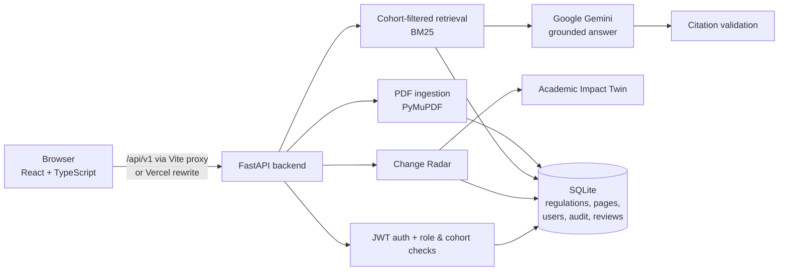

# CohortIQ

CohortIQ is a cohort-aware academic regulation assistant. Students and staff ask questions in plain language and receive answers grounded in the **approved** regulation documents that apply to their **admission batch and programme**, with citations to the document, version and page.

Academic rules change between regulation versions, batches and programmes, so a correct rule from the wrong regulation is still wrong. CohortIQ keeps every answer tied to the regulation that applies to the person asking, and says so plainly when the documents do not support an answer.

> CohortIQ is a guidance tool. It does not make official academic decisions; always check the cited page.

---

## Roles

| Role | How the account is created | What it can do |
|---|---|---|
| **Student** | Public self-registration with an email at the configured student domain, plus admission batch and programme | Ask questions, read approved regulations for their own cohort, see approved updates, use *My Academic Impact Twin* |
| **Staff / Teacher** | Created by an administrator (no public sign-up) and assigned one batch and programme | Same as a student, within the assigned cohort |
| **Administrator** | Created only with the command-line script (no public sign-up, no API endpoint) | Upload and approve regulations, run Change Radar, manage users, read the audit log |

Choosing a role on the sign-in page does not grant it. The backend checks the account's stored role, email domain and cohort on every request.

---

## Features

### Implemented and tested
- **Cohort-aware retrieval:** questions search only approved regulations whose recorded batches and programmes match the signed-in account. The cohort is read from the account on the server; requests for another cohort return 403.
- **Grounded answers with citations:** retrieval runs first (BM25), then Google Gemini writes an answer from the retrieved passages only. Citations are validated against the retrieved text; unsupported citations are removed, and an answer is only marked grounded when at least one citation survives.
- **Abstention:** out-of-scope or weakly supported questions return "no grounded answer" with a reason instead of an invented rule.
- **PDF ingestion:** administrators upload PDFs with document name, version, effective date, batches and programmes. Text is extracted page by page (PyMuPDF) and stored with page numbers. New documents always start as **pending**.
- **Approval workflow:** administrators approve, reject or return documents to pending. Only approved documents are searchable.
- **Stored Regulations:** a document-management page with search, filters, sorting, original filename, page count, applicability, and extraction and approval status.
- **Change Radar:** compares two versions of the same document clause by clause and lists additions, removals and modifications with page references from both versions. Reviews start as *Needs review*; students see an update only after an administrator approves the review **and** the new regulation is approved, and only if their cohort is in the review's applicability.
- **My Academic Impact Twin:** for students and staff, it classifies each approved, applicable Change Radar difference as *Potential Impact*, *Requires Review* or *No Direct Impact Identified*, using a deterministic comparison of the two clause texts. It shows both passages, page references and review points.
- **User management and audit log:** administrators create students and staff, deactivate and reactivate accounts, unlock them, reset passwords and revoke sessions. Security and workflow events are recorded without passwords, tokens, emails or question text. The audit log page has filters, pagination and event details.
- **Web interface:** a public site (Home, Features, How It Works, About), sign-in and registration, and role-specific dashboards. Includes light and dark themes and a responsive layout.

### Limitations (current)
- **Original PDFs are not kept.** Only extracted page text is stored, so there is no PDF download. Documents uploaded before filename tracking show "Filename unavailable for legacy upload".
- **No public staff registration and no email verification.** Student registration checks the email domain but does not send a verification email.
- **Change Radar pairs clauses by position.** Many differences therefore land in *Requires Review* and need a human to read both passages.
- **The Impact Twin works at cohort level only.** CohortIQ holds no verified attendance, credits, marks or exam records, so it never says whether a student is personally eligible. The service has a `PersonalRecordProvider` hook for integrating verified records later.
- **Change Radar reviews have no "rejected" state.** Returning a review to *Needs review* withdraws it from students.
- **Answer latency depends on Gemini:** typically 20–60 seconds, and free-tier quotas are small (see [Gemini](#gemini)).

### Not implemented
- Individual eligibility simulations.
- Hosted cloud backend; the demo deployment relies on a tunnel (see [Deployment](#deployment)).

---

## Architecture



Question flow: **sign-in → cohort from account → approved applicable passages (BM25) → Gemini answer from those passages → citation validation → answer with document/version/page.**

| Layer | Technology |
|---|---|
| Frontend | React 19, TypeScript, Vite, Vitest + Testing Library |
| Backend | FastAPI, Uvicorn, Pydantic |
| Auth | JWT (PyJWT), Argon2 password hashing, account lockout |
| Storage | SQLite (`data/cohortiq.db` by default) |
| PDF | PyMuPDF |
| Retrieval | BM25 (`rank-bm25`) over page chunks |
| AI | Google Gemini via `google-genai` |

### Repository layout
```
backend/app/        FastAPI app: api/v1 routes, auth, audit, schemas, services
backend/tests/      Backend API, security and service tests
backend/scripts/    create_admin.py (administrator provisioning)
app/                Core pipeline: database, PDF processing, chunking, retrieval, Gemini, citation validation
                    (app/main.py is the earlier Streamlit prototype)
frontend/           React web interface
evaluation/         Offline retrieval/routing evaluation
tests/              Core pipeline tests
```

---

## Setup (Windows PowerShell)

Prerequisites: Python 3.11 or newer, Node.js 20 or newer, and a Google Gemini API key.

```powershell
cd C:\path\to\CohortIQ1

# Backend environment
python -m venv .venv
.\.venv\Scripts\Activate.ps1
pip install -r requirements.txt

# Configuration
Copy-Item .env.example .env
notepad .env            # fill in the values described below
```

Generate a JWT secret:
```powershell
python -c "import secrets; print(secrets.token_urlsafe(48))"
```

### Environment variables (`.env`, never commit it)

| Variable | Purpose |
|---|---|
| `GEMINI_API_KEY` | Google Gemini API key |
| `GEMINI_MODEL` | Gemini model name available to your key (e.g. `gemini-3.5-flash`) |
| `DATABASE_PATH` | SQLite file, default `data/cohortiq.db` |
| `UPLOAD_DIR`, `EXTRACTED_DIR` | Working directories, default `data/uploads`, `data/extracted` |
| `APP_ENV` | `development`, `test` or `production` (production refuses to start without a strong secret) |
| `JWT_SECRET_KEY` | At least 32 random bytes |
| `JWT_ISSUER`, `JWT_AUDIENCE` | Token issuer and audience |
| `ACCESS_TOKEN_EXPIRE_MINUTES`, `JWT_LEEWAY_SECONDS` | Token lifetime and clock skew |
| `LOGIN_MAX_FAILED_ATTEMPTS`, `LOGIN_LOCKOUT_MINUTES` | Account lockout policy |
| `STUDENT_EMAIL_DOMAIN`, `STAFF_EMAIL_DOMAIN`, `ADMINISTRATOR_EMAIL_DOMAIN` | Allowed email domain per role |
| `BACKEND_CORS_ORIGINS` | Optional comma-separated origins if the frontend calls the API cross-origin |
| `MAX_UPLOAD_BYTES`, `MAX_PDF_PAGES` | Optional upload limits (defaults below) |

Frontend (`frontend/.env.local`, optional):

| Variable | Purpose |
|---|---|
| `VITE_API_PROXY_TARGET` | Backend URL for the dev proxy (default `http://127.0.0.1:8000`) |
| `VITE_API_BASE_URL` | Only if the built frontend must call an API on another origin |

### Create the first administrator
The script prompts for the password in a hidden prompt and must run in an interactive terminal:
```powershell
python -m backend.scripts.create_admin --email you@<ADMINISTRATOR_EMAIL_DOMAIN> --full-name "Your Name"
```

### Run
```powershell
# Terminal 1: backend
.\.venv\Scripts\Activate.ps1
python -m uvicorn backend.app.main:app --host 127.0.0.1 --port 8000

# Terminal 2: frontend
cd frontend
npm install
npm run dev              # http://localhost:5173
```
If the backend runs on another port, set `VITE_API_PROXY_TARGET` in `frontend/.env.local` and restart `npm run dev`. **Restart the backend after pulling code changes**: Uvicorn without `--reload` keeps serving the old code.

---

## Regulation PDFs: limits and storage
- **PDF only**, one file per request. The upload page accepts many files and sends them one after another; there is **no application limit on the number of documents** stored.
- **Per-file limits:** 20 MB (`MAX_UPLOAD_BYTES`) and 500 pages (`MAX_PDF_PAGES`). Oversized requests are rejected with HTTP 413 before the body is read; the upload page also checks the size before sending. Unreadable or corrupt PDFs are rejected with a clear error and nothing is saved.
- **Storage:** the upload is written to a temporary file, extracted, then deleted. The regulation's metadata and each page's text are saved together in one transaction in SQLite, along with the original filename. Real capacity is bounded by disk space and SQLite.
- **Visibility:** new uploads are *pending* and are never used for answers until an administrator approves them in **Stored Regulations**.
- To compare versions in Change Radar, upload the new version with **exactly the same document name** and a different version label, and make sure the previous version is approved.

---

## Gemini
- Configure `GEMINI_API_KEY` and a `GEMINI_MODEL` that your key can use.
- Free-tier quotas are per model and can be very small (for example 20 requests per day). When the quota is exhausted, CohortIQ shows "no grounded answer" with a service-failure reason; it never invents an answer. Switching `GEMINI_MODEL` to another available model, or using a paid key, restores answers.
- Answers can take up to about a minute; the web client waits up to two minutes.

---

## Testing
```powershell
.\.venv\Scripts\Activate.ps1
python -m pytest -q                     # backend + core pipeline tests

cd frontend
npm test                                 # Vitest
npm run typecheck
npm run build
```

---

## Deployment
CohortIQ's backend keeps its data in SQLite on the machine that runs it. The current demo setup is:

1. Run the backend locally (see [Run](#run)).
2. Expose it with a tunnel, for example a Cloudflare quick tunnel: `cloudflared tunnel --url http://127.0.0.1:<backend-port>`.
3. Point the `/api/:path*` rewrite in `frontend/vercel.json` at the tunnel URL, commit, and deploy the `frontend` directory to Vercel (Root Directory `frontend`).

Consequences:
- The deployed site works only while the backend machine and the tunnel are running.
- Quick-tunnel URLs change every time the tunnel restarts, so `frontend/vercel.json` must be updated each time.
- Uploaded data lives in the local SQLite file; back it up before demos.

A hosted backend with persistent storage would remove the tunnel dependency; it is not implemented yet.

---

## Security notes
- Never commit `.env`, database files or uploaded documents; `.gitignore` excludes them.
- Students and staff are limited to their stored cohort on every regulation, question, update and Impact Twin request.
- Administrator APIs reject student and staff tokens; public registration can only create students.
- Uploads, approvals, reviews, account changes, sign-ins and denied requests are recorded in the audit log.
